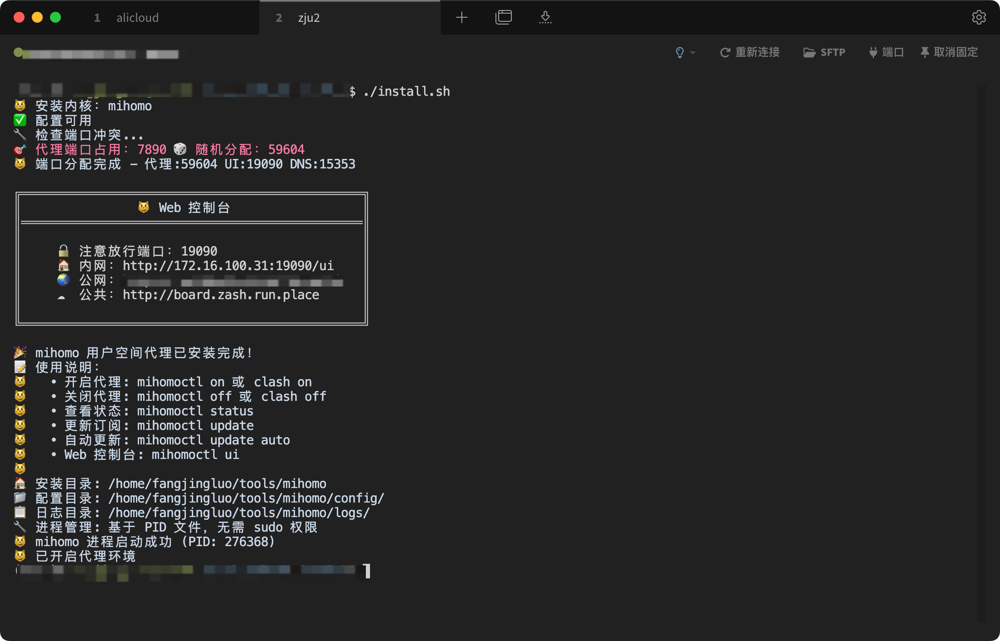
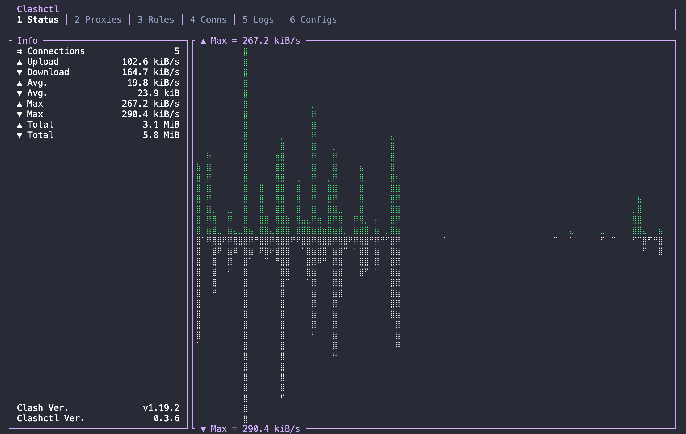

# Clash for Lab - 实验室科学上网工具


<table>
  <tr>
    <td align="center"><b>命令行界面</b></td>
    <td align="center"><b>TUI 交互式界面</b></td>
  </tr>
  <tr>
    <td></td>
    <td></td>
  </tr>
</table>

## 项目简介

Clash for Lab 是给无 sudo、无桌面环境的实验室服务器准备的 mihomo 管理工具。命令体验参考了 [clash-for-linux-install](https://github.com/nelvko/clash-for-linux-install)，内核同步和升级机制在本项目中独立实现。

### 为什么选择 Clash for Lab？

实验室用户通常面临以下困难：

- **无 sudo 权限**：无法安装系统级服务或修改系统配置
- **无 GUI 环境**：只能通过命令行操作，无法使用图形界面工具
- **端口冲突频繁**：多用户共享服务器，常用端口经常被占用

Clash for Lab 把安装、端口分配和日常管理都放在当前用户目录中完成。

### 核心特性

- **用户空间运行**：无需 `sudo` 权限，安装到用户目录 `~/tools/mihomo/`
- **智能端口管理**：自动检测端口冲突并分配可用端口，支持固定端口模式
- **局域网访问控制**：支持按需开放代理端口；管理 API 和 DNS 默认仍只允许本机访问
- **TUI 交互式界面**：终端下的图形化管理界面，实时监控流量和连接状态
- **命令行操作**：完全基于命令行，适合无 GUI 环境
- **稳定版内核**：CI 持续同步 mihomo 最新正式版，明确排除 Alpha 和预览版
- **可校验升级**：支持 SHA256 校验、配置预检、失败回滚和手动退回上一版
- **Linux amd64**：适配主流 x86_64 Linux 发行版（CentOS、Debian、Ubuntu 等）
- **进程管理**：基于 PID 文件管理，无需 systemd 服务
- **订阅转换**：自动使用 [subconverter](https://github.com/tindy2013/subconverter) 进行本地订阅转换

⚡️ 提供一种优雅的方式，一键式脚本安装代理工具。

## 快速开始

只需要 Linux x86_64、`bash` 或 `zsh`，以及系统自带的 `curl`、`tar`、`gzip`。**不需要 sudo**，也不需要 `unzip`、`git`、systemd。

### 一键安装

```bash
curl -fsSL https://raw.githubusercontent.com/SaladDay/clash-for-lab/main/get.sh | bash -s -- '你的订阅地址'
```

订阅地址要用单引号包住。`raw.githubusercontent.com` 连不上时，换成 GitHub API 入口：

```bash
curl -fsSL -H 'Accept: application/vnd.github.raw' https://api.github.com/repos/SaladDay/clash-for-lab/contents/get.sh | bash -s -- '你的订阅地址'
```

安装包也下载不动时，在末尾追加 `--mirror https://镜像地址`，指定一个**你信任的** GitHub 加速镜像。完全无法联网的机器，可以在别处下载仓库再传上去，执行 `bash install.sh '你的订阅地址'`。

安装脚本会校验内核、避开被占用的端口、为管理 API 生成随机密钥、启动代理并检测能否访问外网；任何一步失败都会清理干净。重复执行同一条命令等于升级管理脚本，**配置会保留**；带上新的订阅地址则同时更换订阅。

### 装好之后

新开的终端会自动使用代理，当前终端执行 `exec bash`（zsh 用户 `exec zsh`）即可生效。

```bash
clash status              # 状态和连通性
clash node                # 列出节点，输入序号切换
clash node best           # 测速并切到最快的节点
clash off / clash on      # 关闭 / 开启
clash run pip install x   # 只让这一条命令走代理
clash uninstall           # 卸载
```

代理不通时，依次执行 `clash node best`、`clash update`、`clash doctor`、`clash log`。

## 使用教程

### 切换节点

```bash
clash node use 3            # 按序号
clash node use 日本          # 按名称的一部分
clash node test             # 全部测速
clash node groups           # 查看所有策略组
clash node use 香港 -g 流媒体  # 操作指定策略组
```

选择会被记住，重启后仍然有效。完整命令见 `clash help`。

### 机器重启与共享家目录

机器重启或进程被杀后，下次登录终端时会自动恢复代理；手动 `clash off` 过的不会。不需要时执行 `clash autostart off`，想在后台即时恢复可用 `clash watchdog on`。

多台机器共享同一个 `$HOME` 时，每台机器的进程、端口和日志相互独立，在需要的机器上各执行一次 `clash on` 即可。从旧版本升级时，请先在所有机器上 `clash off`。卸载前同样如此，因为卸载只会停止当前机器的进程。

### 在脚本和 Slurm 作业中使用

安装时会创建 `~/.local/bin/clash`（已有同名命令则不覆盖）。非交互环境里这样加载代理变量：

```bash
eval "$(~/.local/bin/clash env)"
```

注意代理只监听 `127.0.0.1`，作业必须与代理运行在同一台机器上。

### 2. 使用流程

#### 2.1 启动代理服务

```bash
clash on
```

#### 2.2 检查运行状态

```bash
# 查看详细状态信息
clash status

# 输出示例：
# 😼 订阅地址: https://your-subscription-host/***
# 😼 mihomo 进程状态: 运行中
# 😼 进程 PID: 276368
# 😼 运行时间: 04:53
# 😼 配置文件: /home/fangjingluo/tools/mihomo/runtime.yaml
# 😼 日志文件: /home/fangjingluo/tools/mihomo/logs/mihomo.log
# 😼 代理端口: 54016
# 😼 管理端口: 19090
# 😼 DNS端口: 15353
# 😼 系统代理：开启
# http_proxy： http://127.0.0.1:54016
# socks_proxy：socks5h://127.0.0.1:54016
```

#### 2.3 停止代理服务

```bash
# 停止代理
clash off
```

### 3. 高级功能

#### 3.1 固定代理端口

```bash
# 查看当前端口模式和端口
clash port status

# 固定代理端口（如 7890），如遇冲突可按提示重新输入或切换自动
clash port set 7890

# 切换回自动分配端口
clash port auto
```

#### 3.2 局域网访问控制

```bash
# 查看局域网访问状态
clash lan status

# 开启局域网访问（允许其他设备通过本机 IP 使用代理）
clash lan on

# 关闭局域网访问（仅本机可用）
clash lan off
```

开启局域网访问后，其他设备可以通过以下方式使用代理：

- HTTP 代理：`http://your-server-ip:port`
- SOCKS5 代理：`socks5://your-server-ip:port`

> 注意：开启局域网访问前，请设置代理认证并确认网络环境可信，避免代理被未授权使用。该命令不会开放 Web 管理 API 或 DNS。

#### 3.3 TUI 交互式界面

```bash
# 启动 TUI 界面
clash tui
```

TUI 界面基于 [clashctl](https://github.com/George-Miao/clashctl) 项目，首次使用时会从本项目维护的
[clashctl release](https://github.com/SaladDay/clashctl/releases) 下载正式版。下载器会拒绝草稿和预发布版，
并核对 GitHub release 提供的文件大小与 SHA256 后再原子安装，不再经过第三方下载代理。

功能特性：
- 实时流量监控和图表展示
- 查看当前连接数和速度统计
- 切换代理节点和规则
- 查看日志和配置信息

> 提示：使用数字键 1-6 切换不同面板，按 `q` 退出。

#### 3.4 Web 控制台管理

```bash
# 查看控制台地址
clash ui

# 修改自动生成的访问密钥
clash secret your-password

# 查看当前密钥
clash secret
```

全新安装会为管理 API 生成随机密钥，并让管理 API 只监听 `127.0.0.1`。在服务器本机可直接打开 `clash ui` 显示的地址；从自己的电脑访问远程服务器时，先建立 SSH 隧道：

```bash
ssh -L 9090:127.0.0.1:9090 user@server
```

如果 `clash status` 显示的管理端口不是 9090，请把命令中的两个 9090 都替换为实际端口，然后在本机浏览器打开 `http://127.0.0.1:9090/ui`。无需在防火墙中放行管理端口。

通过 Web 控制台可以：

- 切换代理节点
- 查看实时日志
- 监控流量统计
- 测试节点延迟

#### 3.5 订阅管理

```bash
# 设置订阅地址
clash subscribe 'https://your-subscription-url'

# 查看当前订阅
clash subscribe

# 更新订阅配置
clash update
```

订阅地址通常包含 `&` 等 Shell 特殊字符，请始终用单引号包住完整地址，否则 Shell 可能在脚本收到地址前将其截断。

本项目不会自动改写用户的整份 `crontab`。这样可以避免与备份、证书续期等外部定时任务并发时丢失用户数据。
如果旧版本曾通过 `clash update auto` 创建 `mihomoctl_auto_update` 条目，请使用 `crontab -e` 手动删除；
订阅继续用 `clash update` 手动更新，内核稳定包则由本仓库的 GitHub Actions 自动同步。

订阅更新先在临时文件中完成下载和内核校验，校验通过后再替换配置。更新失败时保留原配置。

`clash update log` 只记录更新时间和结果，不记录订阅 URL 或令牌；更新日志权限为 `0600`，订阅转换器的原始输出不会落盘。如果服务原本处于停止状态，更新只发布新配置，不会擅自启动 mihomo。

#### 3.6 内核升级

`clash update` 用于更新订阅，内核更新使用单独的 `upgrade` 命令：

```bash
# 从 clash-for-lab 仓库升级到最新稳定版
clash upgrade

# 查看当前版本和可回滚版本
clash upgrade status

# 新版本不兼容时退回升级前的版本
clash upgrade rollback
```

升级器先取得仓库 `main` 的 commit SHA，再从这个不可变 commit 下载版本锁和内核，避免 CI 更新期间读到两套版本。下载完成后会检查压缩包大小、SHA256、内核版本和当前配置。全部通过后才停止旧进程并替换内核；新内核启动失败时自动恢复旧版本。旧安装即使没有状态文件，首次升级也会先记录当前内核身份并保留到 rollback 槽。升级、订阅更新和启停命令共用一把文件锁，多个终端不会同时修改安装目录。

升级器固定使用 GitHub 官方 API、Git 和 Raw 端点，并且只信任 `SaladDay/clash-for-lab` 的 `main` 分支；环境变量不能把版本锁或可执行文件重定向到其他仓库。

mihomo 上游没有单独的 LTS 通道。本项目只同步 GitHub `releases/latest` 指向的正式稳定版，并再次检查 `draft=false`、`prerelease=false`，不会安装 `Prerelease-Alpha`。

#### 操作边界

安装目录归当前 Unix 用户所有，本项目把同一 UID 视为可信。请不要在 `clash` 命令运行期间手工替换 `~/tools/mihomo/` 下的配置、内核或管理脚本。命令开始时会拒绝关键路径上的符号链接和特殊文件，正常的并发命令由文件锁串行执行；不处理同一用户在命令执行中故意制造的路径切换、旧文件描述符写入或 TOCTOU 攻击。

仓库维护者需要在 GitHub 的 Actions 设置中允许 `GITHUB_TOKEN` 写入仓库内容。如果 `main` 的 ruleset 禁止 Actions 直接推送，同步任务会按规则失败；需要由维护者明确允许 GitHub Actions 写入，或把发布步骤改成走 PR。同步任务本身不会强推或绕过已经前进的 `main`：验证期间只要分支发生变化，本轮发布就会失败并等待下一次定时任务。

已经安装过旧版的用户，拉取本仓库新代码后可以先刷新管理脚本：

```bash
git pull
bash install.sh --refresh
```

刷新时旧的管理脚本会完整移到 `~/tools/mihomo/script.recovery.*`，而不是直接删除。确认其中没有自定义内容后，可以手动清理这些目录。

### 卸载

```bash
clash uninstall     # 或在仓库目录执行 bash uninstall.sh
```

卸载脚本会先停止受管进程、清理 shell 入口，再删除标准安装目录 `~/tools/mihomo/`。安装中途失败时会清理本次新建的标准安装目录；如果进程或 shell 入口无法恢复，则保留现场并提示检查路径。

#### 3.7 高级配置

```bash
# 编辑自定义配置（Mixin）
clash mixin -e

# 查看运行时配置
clash mixin -r

# 启用 TUN 模式（暂时还不好用,建议别用）
clash tun on
```

**Mixin 配置说明**：

Mixin 配置文件（`~/tools/mihomo/mixin.yaml`）用于自定义代理行为，支持以下配置：

- `mode`：代理模式（rule/global/direct），默认为 rule 模式
- `allow-lan`：局域网访问控制
- `external-controller`：Web 控制台监听地址
- 其他高级配置项

通过 Web UI 修改的配置（如代理模式）会在下次启动时保留。

`clash on`、`restart`、`port` 和 `mixin` 都先生成并校验候选运行配置，再替换当前配置。失败时保留原配置和原来的运行状态。

## 项目结构

```
clash-for-lab/
├── get.sh                  # 一键安装入口
├── install.sh              # 主安装脚本
├── uninstall.sh            # 卸载脚本
├── script/                 # 脚本目录
│   ├── clashctl.sh         # 主控制脚本
│   ├── clash-cli           # 供脚本和作业调用的命令入口
│   ├── common.sh           # 公共函数库
│   ├── node.sh             # 节点查看、切换、测速
│   ├── install-lib.sh      # 管理脚本原子发布
│   ├── log-writer.sh       # 有大小上限的私有日志写入器
│   └── upgrade.sh          # 稳定版内核升级与回滚
├── resources/              # 资源文件
│   ├── mihomo.lock.tsv     # CI 生成的稳定版版本锁
│   ├── mixin.yaml          # Mixin 配置模板
│   ├── Country.mmdb        # GeoIP 数据库
│   ├── GeoSite.dat         # GEOSITE 规则数据，避免首次启动时从 GitHub 下载
│   └── zip/                # CI 维护的内核包及其他预编译资源
├── tools/                  # CI 同步脚本
├── tests/                  # 同步、安装包、升级和回归测试
└── README.md               # 项目文档
```

### 安装后目录结构

```
~/tools/mihomo/             # 用户安装目录
├── bin/                    # 二进制文件
│   ├── mihomo              # 主程序
│   ├── subconverter        # 订阅转换工具
│   │   └── latest.log      # 私有占位文件；转换器原始输出不落盘
│   ├── yq                  # YAML 处理工具
│   ├── mihomo.previous     # 首次升级后保存的上一版内核
│   └── clashctl-tui        # TUI 界面 (首次使用时自动下载)
├── config/                 # 配置文件
│   ├── mihomo.pid          # 进程 ID 文件
│   └── ports.conf          # 当前端口状态
├── config.yaml             # 订阅配置
├── mixin.yaml              # 自定义配置
├── runtime.yaml            # 合并后的运行配置
├── mihomoctl.log           # 不含订阅 URL/令牌的更新记录，权限 0600
├── Country.mmdb            # GeoIP 数据库
├── logs/                   # 日志文件
│   └── mihomo.log          # 运行日志，权限 0600，硬上限 8 MiB
├── state/                  # 当前与可回滚内核的包信息和二进制身份
└── ui/                     # Web 控制台文件
```

## 常见问题

### Q: 代理突然不能用，但 clash status 显示进程在运行？

A: mihomo 进程可能已被停止（如被 OOM Killer 杀掉），但当前终端仍持有旧的代理环境变量。执行 `clash doctor` 诊断并自动清除过期的代理变量。新开的终端会自动检测并清除。

`clash status` 现在包含连通性探测，会检查管理 API 和代理端口的实际可达性。如果探测拖慢了状态查询，可以使用 `clash status --no-probe` 跳过。

### Q: SSH 断开后代理服务会停止吗？

A: 不会。服务使用 `nohup` 在后台运行，SSH 断开后仍然保持运行。

### Q: 如何在多个终端会话中使用代理？

A: 代理服务是全局的，在任何终端中执行 `clash on` 后，所有终端都可以使用代理。

### Q: 可以同时运行多个实例吗？

A: 不建议。每个用户建议只运行一个实例，避免端口冲突和配置混乱。

### Q: 如何更换订阅地址？

A: 使用 `clash subscribe 'new-url'` 保存新地址，然后按提示立即更新，或稍后执行 `clash update`。单引号可以防止 Shell 解析地址中的 `&` 等特殊字符。

### Q: 如何更新 mihomo 内核？

A: 使用 `clash upgrade`。它只从本项目 GitHub 仓库获取 CI 校验过的正式稳定版；如需退回上一版，执行 `clash upgrade rollback`。

### Q: Web 控制台无法访问怎么办？

A: 管理 API 默认只监听本机，这是预期行为。先用 `clash status` 确认实际管理端口，再从自己的电脑建立 `ssh -L 本地端口:127.0.0.1:管理端口 user@server` 隧道；不需要把管理端口暴露给公网。

### Q: 旧安装如何采用新的本机监听默认值？

A: `bash install.sh --refresh` 不会覆盖已有的自定义 Mixin。请执行 `clash mixin -e`，把 `external-controller` 改为 `127.0.0.1:端口`、`dns.listen` 改为 `127.0.0.1:端口`，再执行 `clash secret 新密钥`。保存 Mixin 后执行 `clash restart`。

### Q: mihomo 日志会一直增长吗？

A: 不会。管理脚本以 `0600` 创建日志，并将 `mihomo.log` 限制在 8 MiB；达到上限时会开始新的日志窗口，避免长期运行耗尽用户配额。

### Q: 如何让局域网内其他设备使用代理？

A: 使用 `clash lan on` 开启局域网访问，然后在其他设备上配置代理服务器为本机 IP 和代理端口。可以通过 `clash status` 查看当前代理端口。

### Q: 代理模式在重启后会恢复默认吗？

A: 不会。通过 Web UI 修改的代理模式（rule/global/direct）会自动保存到 mixin 配置中，重启后会保留您的设置。

## 致谢

稳定版发现与命令体验参考了 [clash-for-linux-install](https://github.com/nelvko/clash-for-linux-install)。本项目的同步和升级代码为独立实现，感谢上游项目提供思路。

### 相关项目

- [mihomo](https://github.com/MetaCubeX/mihomo) - 高性能的代理内核
- [subconverter](https://github.com/tindy2013/subconverter) - 订阅转换工具
- [zashboard](https://github.com/Zephyruso/zashboard) - Web 控制台界面
- [yq](https://github.com/mikefarah/yq) - YAML 处理工具
- [clashctl](https://github.com/George-Miao/clashctl) - TUI 交互式控制界面

### 参考资料

- [Clash 知识库](https://clash.wiki/)
- [Clash 配置文档](https://clash.wiki/configuration/configuration-reference.html)
- [mihomo 文档](https://wiki.metacubex.one/)

## 许可证

本项目采用与原项目相同的开源许可证。

## 免责声明

1. 编写本项目主要目的为学习和研究 Shell 编程，不得将本项目中任何内容用于违反国家/地区/组织等的法律法规或相关规定的其他用途。
2. 本项目保留随时对免责声明进行补充或更改的权利，直接或间接使用本项目内容的个人或组织，视为接受本项目的特别声明。
3. 使用本项目所产生的任何后果由使用者自行承担。

## Star History

[](https://star-history.dera.page/#SaladDay/clash-for-lab&Date)
